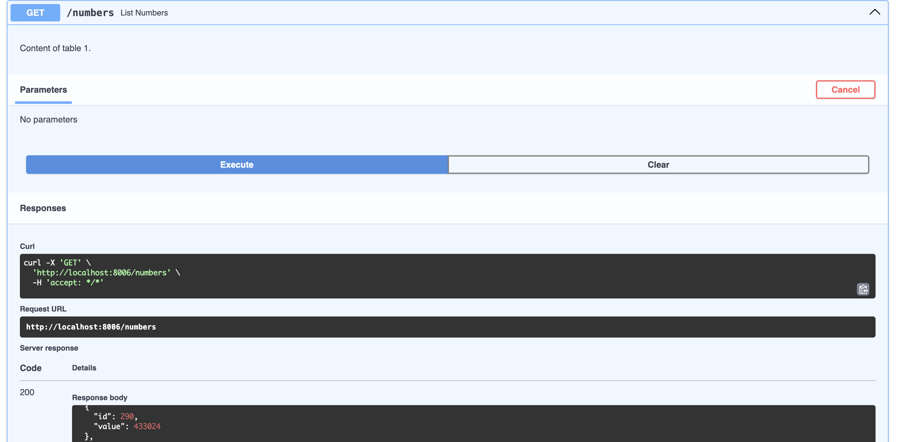
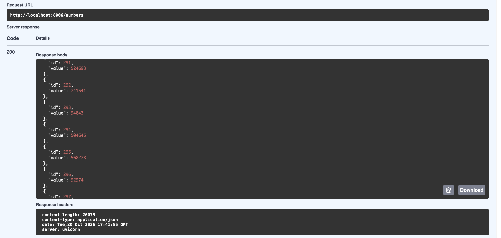
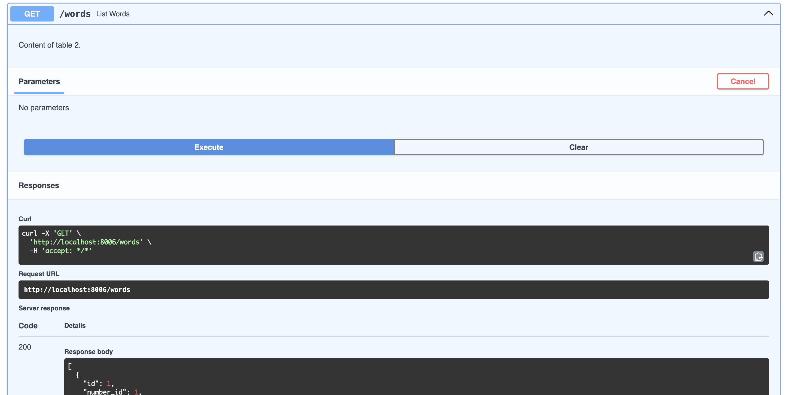
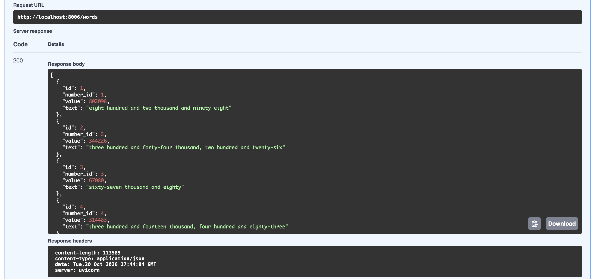
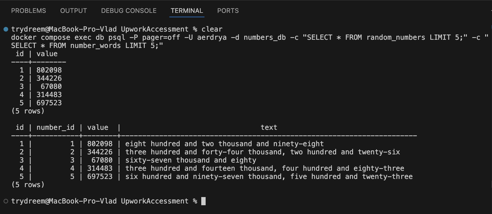
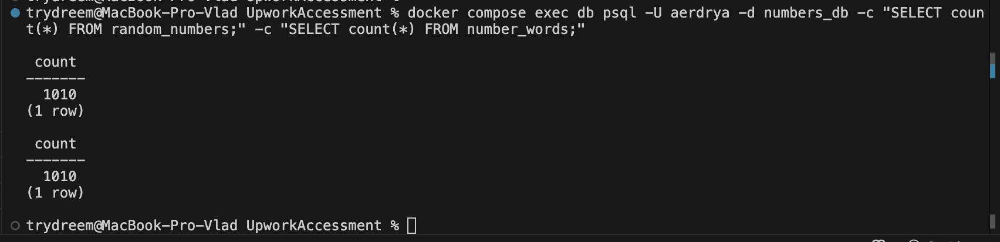

# Aerdrya Backend Task: number → text service

FastAPI app + PostgreSQL, run with Docker Compose.
It reads random numbers from table 1 (`random_numbers`), converts each to English text
(`7` → `seven`) and stores the result in table 2 (`number_words`).

## Run

```bash
cp .env.example .env        # optional, defaults work without it
docker compose up --build
```

Swagger UI: http://localhost:8006/docs

## Use

```bash
curl -X POST "http://localhost:8006/seed?count=20"   # fill table 1 with random numbers
curl -X POST  http://localhost:8006/convert           # table 1 -> table 2
curl http://localhost:8006/numbers                    # content of table 1
curl http://localhost:8006/words                      # content of table 2
```

Or click through the same endpoints in Swagger UI (`/docs`).

## Screenshots

Table 1 (`GET /numbers`, source random numbers):




Table 2 (`GET /words`, numbers written out as text):




## Look at the tables directly

The same data straight from PostgreSQL (`psql`), and the row counts of both tables:




```bash
docker compose exec db psql -U aerdrya -d numbers_db \
  -c "SELECT * FROM random_numbers;" \
  -c "SELECT * FROM number_words;"
```

## Tests

Requires Python 3.12 (the same version as the Docker image):

```bash
python3.12 -m venv .venv && source .venv/bin/activate
pip install -r requirements-dev.txt
pytest
ruff check . && ruff format --check .
```

Or without a local Python, in a throwaway container:

```bash
docker run --rm -v "$PWD":/code -w /code python:3.12-slim \
  sh -c "pip install -q -r requirements-dev.txt && pytest -p no:cacheprovider"
```

Tests use an in-memory SQLite database, so no Postgres is needed.

## Structure

```
app/
  main.py              FastAPI routes (thin HTTP layer)
  config.py            settings from environment variables
  db.py                engine, session dependency, Base
  models.py            RandomNumber (table 1), NumberWord (table 2)
  schemas.py           response models
  services/seeder.py   fills table 1
  services/converter.py number → text + table 1 → table 2 logic
tests/                 unit tests for the converter + API tests
Dockerfile, docker-compose.yml, requirements*.txt, pyproject.toml (ruff, pytest)
docs/CONCEPT.md        microservices concept and outlook
```

## Design notes

- `/convert` is idempotent: it only processes numbers that have no row in table 2 yet
  (`WHERE id NOT IN (SELECT number_id FROM number_words)`), so it can be re-run safely.
- `number_words.number_id` is `UNIQUE` + foreign key, so one number can't be converted twice.
- `number_words.value` duplicates the source number on purpose, so table 2 is readable on its own (screenshots).
- Business logic lives in `services/`, not in routes, so it can later be reused by a worker.
- Postgres healthcheck makes the app wait until the DB accepts connections.
- Tables are created on startup with `create_all` for simplicity; see the concept doc for Alembic.
- Known limit: two `/convert` calls at the exact same moment can collide on the `UNIQUE` constraint. A queue with a single consumer (see concept doc) removes this.
- The container runs as a non-root user; runtime and dev dependencies are separated.
